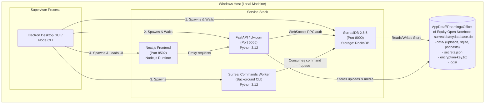

# Office of Equity Open Notebook — Master Troubleshooting & Architecture Guide

## 1. Executive Summary

This master document details the architecture, service interactions, failure signatures, root-cause diagnosis, and permanent remediations for the **Office of Equity Open Notebook** desktop/web stack. It is compiled for cross-environment debugging, including work performed in local IDEs or Google Android Studio (e.g., when embedding, port forwarding, or testing via Android WebViews and emulators).

---

## 2. Architecture & Service Map

The application consists of four coordinated local services orchestrated by an Electron supervisor (`main.js` / `scripts/start-services.js` / `scripts/lib/supervisor.js`):



### Port Allocation & Binding Details
| Service | Port | Protocol | Binding Address | Ready Probe Mechanism | Default Timeout |
| :--- | :--- | :--- | :--- | :--- | :--- |
| **SurrealDB** | `8000` | HTTP / WebSocket (`/rpc`) | `127.0.0.1` | TCP socket connection (`net.Socket`) | 120s |
| **FastAPI Backend** | `5055` | HTTP REST / Docs | `127.0.0.1` | TCP socket connection | 300s (5 min) |
| **Worker** | *None* | CLI background process | *N/A* | Process liveness check (`LIVENESS_SETTLE_MS`) | N/A |
| **Next.js Frontend** | `8502` | HTTP / HTML | `127.0.0.1` | TCP socket connection | 180s (3 min) |

---

## 3. Key File System Paths

### Installed Runtime vs. Repository Source
* **Installed Application Directory**:
  `C:\Program Files\Office of Equity Open Notebook\`
  * Main Executable: `Office of Equity Open Notebook.exe`
  * Packaged Resources: `resources\app\`
  * Bundled Python Runtime: `resources\runtime\python\python.exe` (Python 3.12)
  * Bundled Node.js Runtime: `resources\runtime\node\node.exe` (Node v22.23.2)
  * Bundled SurrealDB Binary: `resources\runtime\surreal\surreal.exe` (v2.6.5)
  * Backend Python Source: `resources\runtime\backend\`
  * Frontend Server Build: `resources\runtime\frontend\server.js`

* **Source Code Repository**:
  `C:\Users\cruzmars\Office-Equity-Open-Notebook\`
  * Service Supervisor: `scripts/start-services.js`
  * Process Table & Envs: `scripts/lib/service-table.js`
  * Encryption & Credential Logic: `scripts/lib/encryption-key.js`
  * Process Supervision: `scripts/lib/supervisor.js`
  * Headless Services Runner: `scripts/run-services.js`

* **User Data Directory (`userData`)**:
  `C:\Users\cruzmars\AppData\Roaming\Office of Equity Open Notebook\`
  * Database Store: `surrealdb\mydatabase.db` (RocksDB directory structure)
  * App Data: `data\` (`uploads\`, `podcasts\`, `sqlite-db\checkpoints.sqlite`)
  * Local Secrets: `secrets.json` (Stores `surrealPassword`)
  * Encryption Key: `encryption-key.txt` (Protects stored API keys)
  * Service Logs: `logs\` (`api.log`, `surrealdb.log`, `frontend.log`, `worker.log`)

---

## 4. Diagnostic Case Study: Port 5055 Startup Timeout

### Symptoms
1. Electron dialog on startup:
   ```text
   Office of Equity Open Notebook — failed to start
   Timed out waiting for API on port 5055
   ```
2. The UI window failed to appear or exited immediately.

### Log Signatures
* `api.log`:
  ```text
  WARNING | api.main:_wait_for_database:155 - Database is not reachable yet (attempt 1/12):
  There was a problem with the database: There was a problem with authentication. Retrying in 1 seconds...
  ```
* `surrealdb.log`:
  ```text
  WARN surrealdb::core::kvs::ds: Credentials were provided, but existing root users were found.
  The root user 'root' will not be created
  ```

### Root Cause (Deep Dive)
1. **RocksDB Directory vs. File Assumption**:
   SurrealDB's persistent storage engine is RocksDB (`rocksdb:...mydatabase.db`).
   On Windows NTFS, `mydatabase.db` is represented as a **directory** containing `.sst` and `.log` files, not a single file.
2. **Defective Detection Function**:
   `scripts/lib/encryption-key.js` had the following detection function:
   ```javascript
   function hasExistingDatastore(dataDir) {
     const file = path.join(dataDir, DATABASE_DIRNAME, DATABASE_FILENAME);
     try {
       return fs.statSync(file).size > 0;
     } catch (_) {
       return false;
     }
   }
   ```
   Calling `fs.statSync()` on any directory in Node.js on Windows returns `size: 0`.
   Consequently, `0 > 0` always evaluated to `false`.
3. **Password Overwrite & Desync**:
   * Because `hasExistingDatastore()` returned `false`, `resolveDatabaseCredentials()` assumed this was a brand-new install with no existing database.
   * It invoked `ensureDatabasePassword()`, generated a random 24-byte password (`enH4A4gCX6xOWds-UH6zzsRGIK8iPMzv`), and saved it into `secrets.json`.
   * When SurrealDB started with `--user root --pass <generated_password>`, SurrealDB detected existing root credentials in `mydatabase.db` from its original setup (`root:root`) and logged:
     `Credentials were provided, but existing root users were found. The root user 'root' will not be created.`
   * Meanwhile, the supervisor passed `SURREAL_PASSWORD: <generated_password>` to FastAPI's environment.
   * When FastAPI's `lifespan` hook attempted to execute migrations, `db.signin()` failed with `There was a problem with authentication`.
   * FastAPI stalled in its 12-attempt retry loop for ~120 seconds, exceeding the supervisor's `waitForPort(5055)` timeout.

---

## 5. Applied Remediations

### Fix 1: Database Password Alignment in `userData`
File: `C:\Users\cruzmars\AppData\Roaming\Office of Equity Open Notebook\secrets.json`
```json
{
  "surrealPassword": "root"
}
```

### Fix 2: Permanent Fix for `hasExistingDatastore`
File: `C:\Users\cruzmars\Office-Equity-Open-Notebook\scripts\lib\encryption-key.js`
```javascript
/** True when `dataDir` already holds a SurrealDB datastore from an earlier run. */
function hasExistingDatastore(dataDir) {
  const file = path.join(dataDir, DATABASE_DIRNAME, DATABASE_FILENAME);
  try {
    // RocksDB stores its datastore in a directory, which reports size 0 on Windows.
    // Check both for non-empty directories and non-empty files.
    const st = fs.statSync(file);
    if (st.isDirectory()) {
      return fs.readdirSync(file).length > 0;
    }
    return st.size > 0;
  } catch (_) {
    return false;
  }
}
```

### Fix 3: Shell Process Group Detachment
When launching the application from automated scripts or development consoles, Windows terminal sessions wrap spawned children in the job object of the invoking shell. Exiting the shell kills all children unless detached:
* **Detached Explorer Launch**:
  ```cmd
  cmd.exe /c start "" "C:\Program Files\Office of Equity Open Notebook\Office of Equity Open Notebook.exe"
  ```

---

## 6. Diagnostic Toolbelt & Command Reference

### A. Check Port Occupancy & Kill Rogue Listeners (PowerShell)
```powershell
$ports = 8000, 5055, 8502
$listeners = Get-NetTCPConnection -LocalPort $ports -State Listen -ErrorAction SilentlyContinue
if ($listeners) {
    $listeners | ForEach-Object {
        Write-Host "Killing PID $($_.OwningProcess) on port $($_.LocalPort)"
        Stop-Process -Id $_.OwningProcess -Force -ErrorAction SilentlyContinue
    }
} else {
    Write-Host "All ports 8000, 5055, and 8502 are free."
}
```

### B. Verify SurrealDB Auth Directly with Python SDK
Create and execute with the bundled Python runtime (`C:\Program Files\Office of Equity Open Notebook\resources\runtime\python\python.exe`):
```python
import asyncio
from surrealdb import AsyncSurreal

async def test_auth():
    db = AsyncSurreal('ws://127.0.0.1:8000/rpc')
    try:
        await db.signin({'username': 'root', 'password': 'root'})
        await db.use('open_notebook', 'open_notebook')
        res = await db.query('INFO FOR DB;')
        print('SUCCESS: Authenticated to SurrealDB as root')
    except Exception as e:
        print(f'FAILED: {e}')
    finally:
        await db.close()

asyncio.run(test_auth())
```

### C. Verify API Health Endpoint
```powershell
Invoke-RestMethod -Uri 'http://127.0.0.1:5055/api/config' -TimeoutSec 3 | ConvertTo-Json
# Expected response:
# { "version": "...", "latestVersion": ..., "hasUpdate": false, "dbStatus": "online" }
```

### D. Verify Frontend HTTP Response
```powershell
(Invoke-WebRequest -Uri 'http://127.0.0.1:8502' -UseBasicParsing).StatusCode
# Expected response: 200
```

---

## 7. Android Studio & Emulator Considerations

If testing or interfacing with this application via **Google Android Studio** (e.g., using an Android Emulator, Capacitor/Cordova wrapper, or an Android WebView component connecting to this local notebook):

### 1. Loopback IP Translation (`10.0.2.2`)
* Android emulators treat `127.0.0.1` as their own internal loopback interface.
* To reach the host machine running Open Notebook from the Android Emulator:
  * Replace `http://127.0.0.1:8502` with **`http://10.0.2.2:8502`**.
  * Replace `http://127.0.0.1:5055` with **`http://10.0.2.2:5055`**.

### 2. ADB Reverse Port Forwarding
Alternatively, map ports directly through ADB so `localhost` works transparently inside the Android emulator or a physical USB-connected device:
```cmd
adb reverse tcp:8502 tcp:8502
adb reverse tcp:5055 tcp:5055
```
After this command, the Android app/browser can use `http://localhost:8502` and `http://localhost:5055` directly.

### 3. Cleartext Traffic Permission (Network Security Config)
Because the local services bind via standard HTTP (`http://` instead of `https://`), Android 9+ (API level 28+) blocks cleartext traffic by default.
In Android Studio, ensure `AndroidManifest.xml` permits cleartext traffic for local testing:
```xml
<application
    android:usesCleartextTraffic="true"
    ... >
</application>
```
Or define a scoped `res/xml/network_security_config.xml`:
```xml
<?xml version="1.0" encoding="utf-8"?>
<network-security-config>
    <domain-config cleartextTrafficPermitted="true">
        <domain includeSubdomains="true">10.0.2.2</domain>
        <domain includeSubdomains="true">127.0.0.1</domain>
        <domain includeSubdomains="true">localhost</domain>
    </domain-config>
</network-security-config>
```

### 4. CORS Origins Configuration
By default, FastAPI accepts requests from any origin (`CORS_ORIGINS=*`), but if testing from custom Android WebView schemes (such as `capacitor://localhost` or `http://localhost`), you can set the environment variable:
```bash
set CORS_ORIGINS=http://localhost:8502,http://10.0.2.2:8502,capacitor://localhost
```

---

## 8. Service Lifespan & Startup Checklist

When launching the full stack from fresh state:
1. Ensure ports `8000`, `5055`, and `8502` are unallocated.
2. Confirm `secrets.json` matches the credentials initialized in `mydatabase.db`.
3. Launch `Office of Equity Open Notebook.exe` or run `node scripts/run-services.js`.
4. Allow **60–90 seconds** on Windows for initial startup:
   * SurrealDB takes ~1–2s.
   * FastAPI imports PyTorch, Docling, and Transformers before starting Uvicorn (~60–80s).
   * Next.js compiles/renders pages and reports `✓ Ready in 0ms`.
5. Verify health:
   * `http://127.0.0.1:8502` -> `HTTP 200`
   * `http://127.0.0.1:5055/api/config` -> `"dbStatus": "online"`
